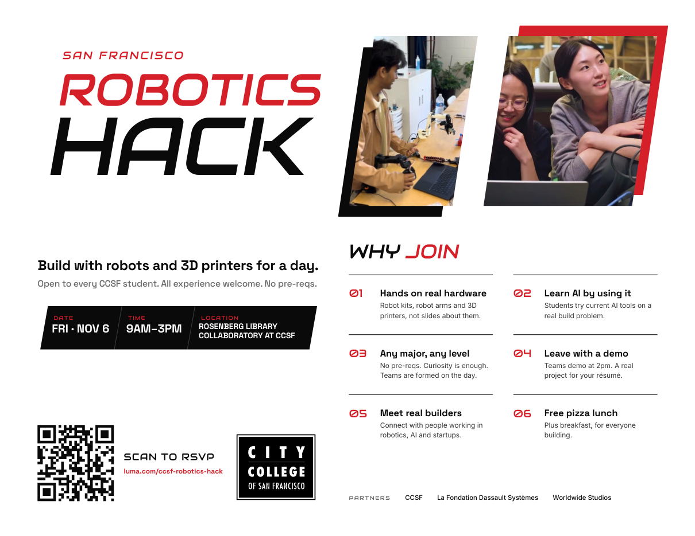
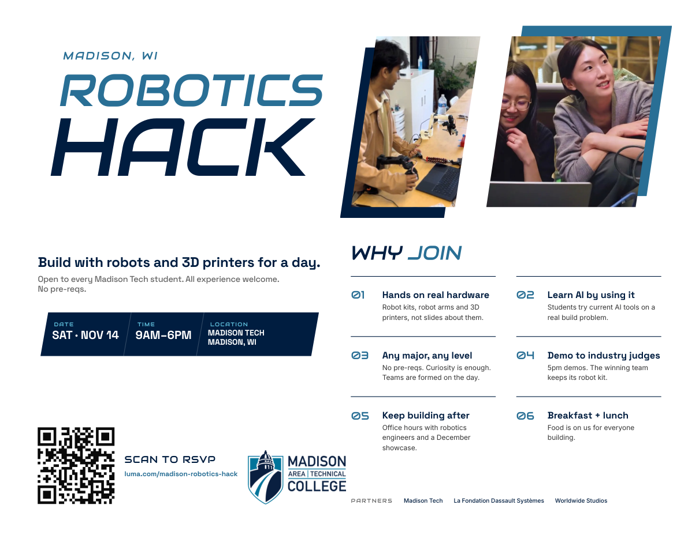
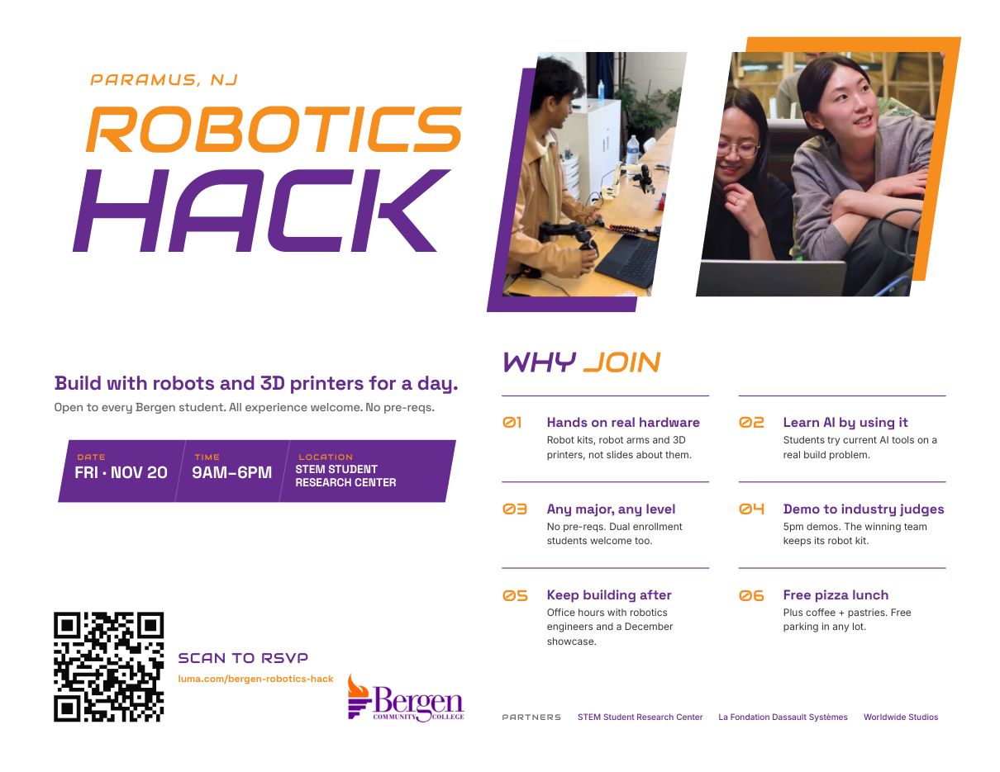

# Community College Robotics Hacks

Resources and curriculum for the fall 2026 one-day robotics hacks, run by [Worldwide Studios](https://worldwide-studios.org) with La Fondation Dassault Systèmes and each host college.

Every hack is a full day of building with robot kits, 3D printers and AI tools. They're open to every student at the host college, in any major. No experience or pre-reqs needed.

## Hacks

| College | Date | Time | Location | RSVP | Poster |
|---|---|---|---|---|---|
| City College of San Francisco | Fri, Nov 6 | 9am–3pm | Rosenberg Library Collaboratory at CCSF, San Francisco, CA | [luma.com/ccsf-robotics-hack](https://luma.com/ccsf-robotics-hack) | [PDF](posters/ccsf-robotics-hack-poster-11x8.5.pdf) |
| Madison Tech | Sat, Nov 14* | 9am–6pm | Madison Tech, Madison, WI | [luma.com/madison-robotics-hack](https://luma.com/madison-robotics-hack) | [PDF](posters/madison-robotics-hack-poster-11x8.5.pdf) |
| Bergen Community College | Fri, Nov 20 | 9am–6pm | STEM Student Research Center, Paramus, NJ | [luma.com/bergen-robotics-hack](https://luma.com/bergen-robotics-hack) | [PDF](posters/bergen-robotics-hack-poster-11x8.5.pdf) |

\* Madison's date is still being confirmed. Check the Luma page for the latest.

## Posters

Each poster is an 11 × 8.5 in landscape PDF. Print it, share it with faculty, or attach it to an online class announcement.

### City College of San Francisco

### Madison Tech

### Bergen Community College

